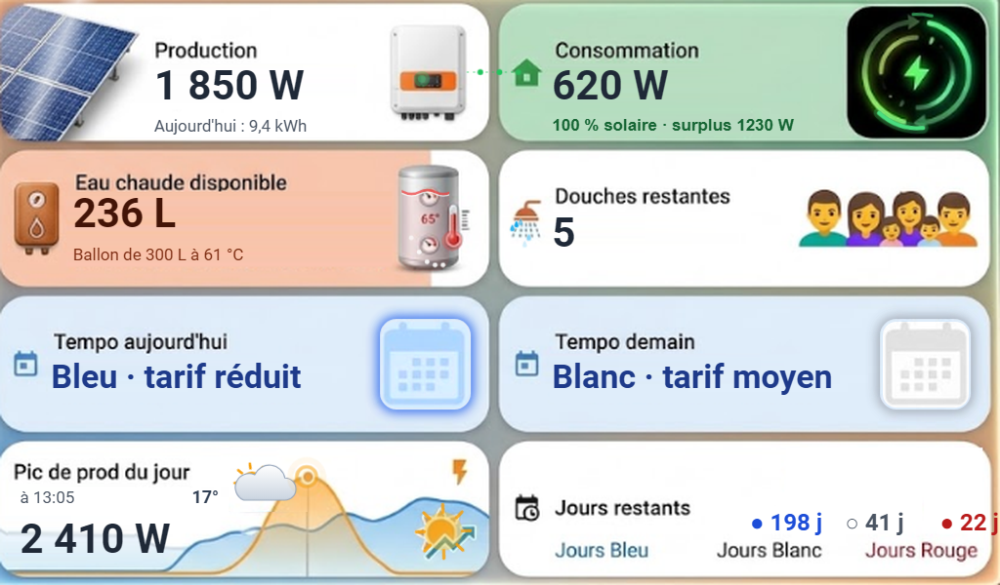

# Nest Hub Solaire

[](https://my.home-assistant.io/redirect/hacs_repository/?owner=remisco&repository=nesthub-solaire&category=plugin)

Carte **Home Assistant** plein écran pour **Google Nest Hub** : production solaire, consommation, eau chaude, douches restantes, couleurs **EDF Tempo** et **météo en temps réel**, sur une image de fond illustrée animée en HTML/SVG.



*Aperçu avec des valeurs d'exemple.*

## Ce qu'elle affiche

| Zone | Valeurs | Animation |
|---|---|---|
| Production | Puissance instantanée, énergie du jour | Reflet de lumière et étincelles sur les panneaux (vitesse selon la production), voile sombre la nuit, voyant de l'onduleur, flux d'énergie vers la maison |
| Consommation | Puissance, « 100 % solaire · surplus X W » ou « Réseau : X W » | Arcs lumineux qui tournent (vitesse selon la consommation), verts en autoconsommation, orange sur le réseau |
| Eau chaude | Litres à 38 °C disponibles, température du ballon | Niveau d'eau qui ondule, couleur selon la température, bulles, halo du thermomètre |
| Douches restantes | Nombre de douches | Une goutte qui tombe par douche restante |
| Tempo aujourd'hui / demain | Couleur et tarif | Texte et icône calendrier à la couleur du jour, avec un halo |
| Pic de production | Valeur et heure du pic du jour (lu dans l'historique) | Soleil qui rayonne, éclair qui scintille, onde sur le sommet de la courbe |
| Météo | Temps actuel et température | Soleil, lune et étoiles, nuages qui dérivent, pluie, averse, neige, orage, brouillard, vent |
| Jours Tempo restants | Bleu / Blanc / Rouge | — |

Tout est calculé dans la carte : **aucun capteur template, aucune autre carte personnalisée, aucune image à copier**.

## Installation avec HACS (recommandé)

1. Cliquez sur le bouton **Ouvrir dans HACS** ci-dessus, ou dans HACS : **⋮ → Dépôts personnalisés**, ajoutez `https://github.com/remisco/nesthub-solaire` avec la catégorie **Tableau de bord** (*Dashboard*).
2. Cliquez sur **Télécharger**, puis rechargez la page du navigateur.

HACS ajoute automatiquement la ressource `/hacsfiles/nesthub-solaire/nesthub-solaire-card.js`.

### Installation manuelle de la carte

Copiez [`dist/nesthub-solaire-card.js`](dist/nesthub-solaire-card.js) dans `config/www/`, puis ajoutez la ressource `/local/nesthub-solaire-card.js` (type *Module JavaScript*) dans **Paramètres → Tableaux de bord → ⋮ → Ressources**.

## Configuration

Créez une vue de type **Panneau** (une seule carte en plein écran) avec le chemin `solaire`, et ajoutez-y la carte :

```yaml
views:
  - title: Solaire
    path: solaire
    type: panel
    cards:
      - type: custom:nesthub-solaire-card
        production: sensor.solar_power
        consommation: sensor.house_power
        energie_jour: sensor.solar_energy_today
        import_reseau: sensor.grid_import_power
        temperature_ballon: sensor.water_heater_temperature
        meteo: weather.forecast_home
```

Remplacez les entités par les vôtres.

### Options

| Option | Obligatoire | Par défaut | Description |
|---|---|---|---|
| `production` | oui | — | Puissance produite par les panneaux (W ou kW) |
| `consommation` | oui | — | Puissance consommée par la maison (W ou kW) |
| `energie_jour` | non | — | Énergie produite aujourd'hui |
| `import_reseau` | non | consommation − production | Puissance tirée du réseau |
| `seuil_import` | non | `50` | En dessous de cette puissance importée (W), la maison est considérée « 100 % solaire » |
| `temperature_ballon` | non | — | Température du ballon d'eau chaude (°C) |
| `eau_chaude` | non | calculée | Capteur de litres d'eau chaude disponibles, si vous en avez déjà un |
| `volume_ballon` | non | `300` | Capacité du ballon (L) |
| `temperature_douche` | non | `38` | Température d'une douche (°C) |
| `temperature_eau_froide` | non | `12` | Température de l'eau froide du réseau (°C) |
| `litres_par_douche` | non | `60` | Litres d'eau à 38 °C par douche (environ 8 minutes avec un pommeau classique) |
| `meteo` | non | `weather.forecast_home` | Entité météo |
| `soleil` | non | `sun.sun` | Pour afficher la lune la nuit |
| `tempo_aujourdhui` | non | `sensor.rte_tempo_couleur_actuelle` | Couleur Tempo du jour |
| `tempo_demain` | non | `sensor.rte_tempo_prochaine_couleur` | Couleur Tempo du lendemain |
| `jours_bleu`, `jours_blanc`, `jours_rouge` | non | `sensor.rte_tempo_cycle_jours_restants_*` | Jours Tempo restants |

Les entités Tempo par défaut sont celles de l'intégration [RTE Tempo](https://github.com/hekmon/rtetempo) (HACS).

**Calcul de l'eau chaude** : litres à 38 °C = `volume × (T_ballon − 38) / (38 − T_eau_froide)`, puis douches = litres ÷ 60, arrondi à l'inférieur. C'est de l'eau mitigée (eau du ballon mélangée à l'eau froide) : à 70 °C, un ballon de 300 L fournit environ 370 L à 38 °C, soit 6 douches.

## Affichage sur le Nest Hub

### Prérequis

- Le Nest Hub doit être ajouté à Home Assistant via l'intégration **Google Cast**.
- Home Assistant doit être accessible en **HTTPS avec un certificat valide** : le Nest Hub refuse les pages en HTTP. Au choix :
  - Home Assistant Cloud (Nabu Casa) ;
  - l'add-on **Duck DNS** avec Let's Encrypt (gratuit), puis renseigner l'URL `https://…` dans *Paramètres → Système → Réseau* (URL interne **et** externe).

### Affichage permanent

Créez une automatisation, passez en mode YAML et collez [`automations/nesthub_affichage_permanent.yaml`](automations/nesthub_affichage_permanent.yaml), en remplaçant `media_player.nest_hub` par votre écran.

Toutes les minutes, elle relance la vue si l'écran est au repos (cadre photo, horloge, éteint). Elle n'interrompt jamais une vidéo ou une autre application.

Pour tester tout de suite : *Outils de développement → Actions → `cast.show_lovelace_view`* avec votre écran, `dashboard_path: lovelace` et `view_path: solaire`.

## Bon à savoir

- Le Nest Hub ne transmet pas le toucher à l'affichage Home Assistant : la carte est faite pour être regardée.
- Le Nest Hub coupe l'affichage Cast au bout d'une dizaine de minutes ; l'automatisation le relance dans la minute suivante.
- La carte garde le format 1024 × 600 du Nest Hub et s'adapte à la largeur disponible sur les autres écrans.
- Pour accéder à Home Assistant depuis l'extérieur sans ouvrir de port, l'add-on **Tailscale** fonctionne très bien en complément.

## Version YAML sans carte personnalisée

Le dossier [`installation-manuelle/`](installation-manuelle/) contient l'ancienne version entièrement en YAML (vue picture-elements avec button-card et card-mod, capteurs template, thème et image de fond), pour ceux qui préfèrent tout modifier à la main.

## Licence

[MIT](LICENSE)
